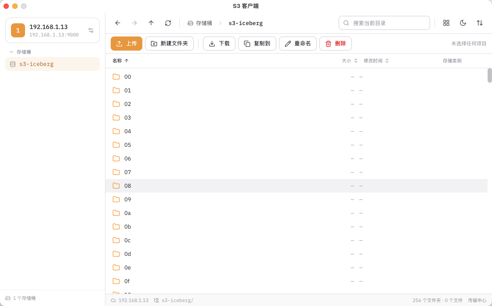

# S3 客户端

一款使用 Go 和 Wails 构建的跨平台桌面 S3 文件管理工具。它可以连接 AWS S3 及兼容 S3 协议的对象存储服务，在桌面界面中浏览和管理存储桶与对象。

## 应用截图



## 功能

- 保存和管理多个 S3 连接，支持配置服务地址、区域、访问密钥、默认存储桶、路径风格和 SSL。
- 测试连接、查询存储桶，并在凭证无权列出存储桶时手动填写存储桶名称。
- 浏览存储桶中的文件和文件夹，支持目录导航、搜索、排序以及列表和网格视图。
- 上传文件或文件夹、下载对象，并查看传输进度和取消正在进行的任务。
- 创建文件夹、复制对象、重命名文件、删除对象和复制对象路径。
- 使用浅色或深色主题，并收藏常用目录。

## 技术栈

- 桌面框架：[Wails](https://wails.io/)
- 后端：Go、AWS SDK for Go v2
- 前端：React、TypeScript、Vite、Tailwind CSS

## 开发环境

请先安装 Go、Node.js、pnpm 和 Wails CLI。然后在项目根目录运行：

```bash
wails dev
```

Wails 会启动桌面应用及前端热更新开发服务器。

## 构建

在项目根目录运行以下命令，生成当前平台的应用构建产物：

```bash
wails build
```

## 项目结构

```text
├── app.go             # Wails 应用生命周期与前端桥接
├── s3service.go       # S3 连接、存储桶和对象操作
├── transfer.go        # 文件上传、下载及传输进度
├── dialog.go          # 原生文件选择对话框
├── frontend/          # React + TypeScript 前端
├── build/             # 应用图标和平台构建配置
└── doc/               # 项目文档与截图
```
